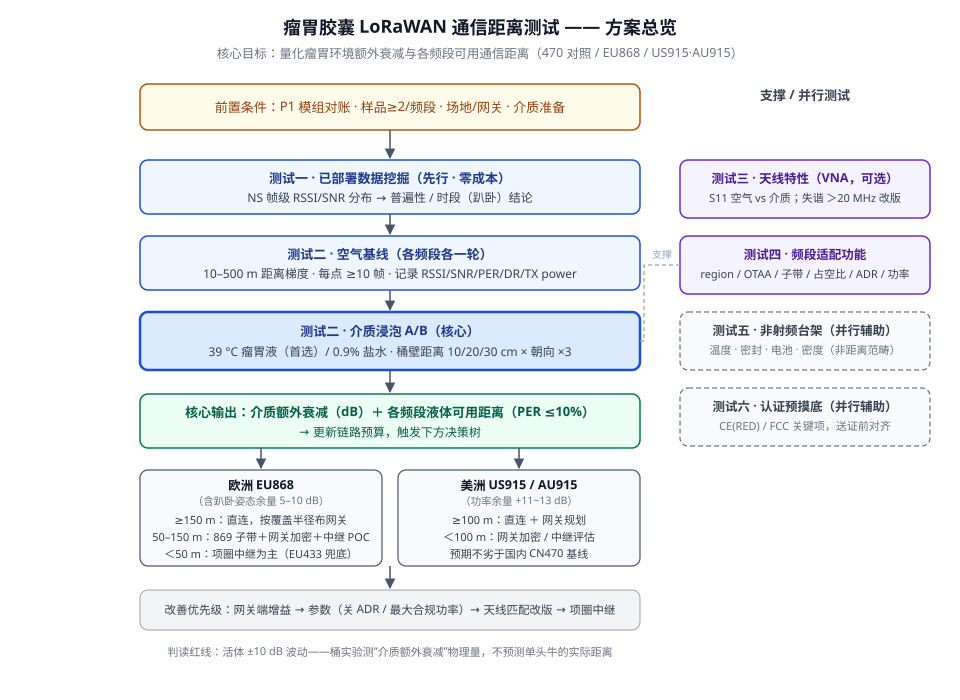
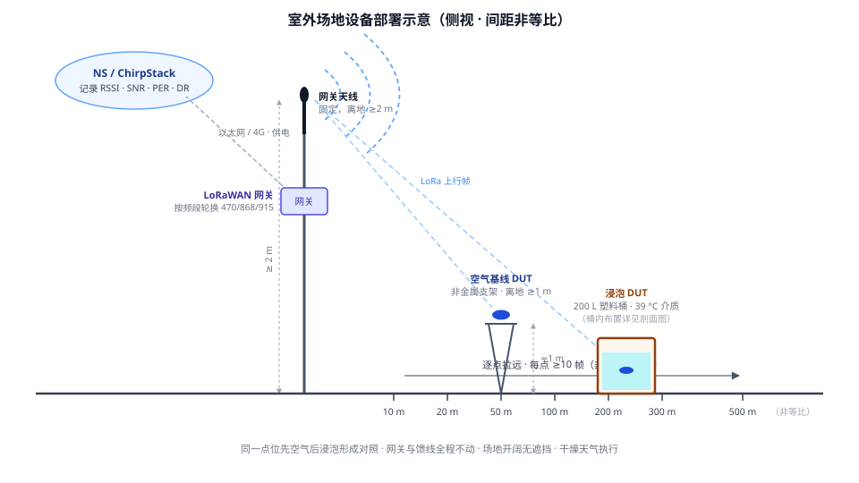
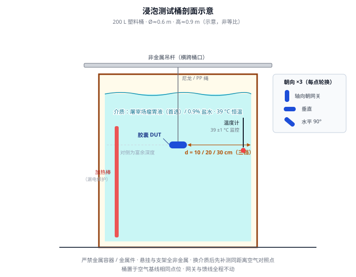

# 瘤胃胶囊 LoRaWAN 通信距离测试方案（无牛验证 · 多频段适配）

| 项 | 内容 |
|---|---|
| 文档版本 | v1.1（草案，待评审） |
| 日期 | 2026-10-08 |
| 适用对象 | RBC-100 瘤胃胶囊（STM32L051 + 利瑞达模组 + STS4x 测温 + BMA456 计步） |
| 范围 | 无牛只条件下的射频/功能/台架验证 + 欧美频段（EU868 / US915 / AU915）适配验证 |
| 不在范围 | 活体动物实验；pH 传感（另项目）；正式认证测试（本方案 §9 仅预摸底） |
| 状态 | ⚠️ 文中标注"待评审"的数值为建议值，需产品/硬件确认后冻结 |

> 变更记录：v1.1（2026-10-08）——聚焦 **LoRaWAN 通信距离** 主线（文档更名），新增图 1–3（方案总览 / 场地设备部署 / 浸泡桶剖面，见 `diagrams/`），测试五、六明确标注为并行辅助项（非通信距离范畴）；v1.0（2026-10-08）——初版。

---

## 1. 背景与目标

### 1.1 背景

1. 客户反馈胶囊体内通信距离远低于标称（标称 500 m 空气视距 vs 体内实际约 1/10 量级）。物理根因：胶囊置于瘤胃后，信号穿液体+组织+体壁额外引入约 20~40 dB 衰减，且电小天线在高介电常数液体中失谐。
2. 主要销售地区为欧洲与美洲，需从 CN470 适配 EU868（欧洲）、US915（北美）/AU915（拉美多国）。
3. 频段切换的链路预算影响（详见 §2.3）：868/915 比 470 自由空间路损高 5.3/5.8 dB，体内吸收随频率再增；EU868 法定功率比 CN470 低 3~5 dB，**欧洲净恶化约 10 dB**；US915 功率余量大，净 +3~5 dB 不劣于国内。

### 1.2 测试目标（可量化）

本方案的核心被测对象是**瘤胃胶囊的 LoRaWAN 通信距离**：以空气基线对照介质浸泡，量化瘤胃环境引入的额外衰减，给出各频段的实际可用通信距离。测试三（天线）、测试四（频段功能）是这条主线的支撑项；测试五（非射频台架）、测试六（认证摸底）为并行辅助项，不属于通信距离范畴。

| # | 目标 | 对应测试 |
|---|---|---|
| G1 | 量化"瘤胃环境额外衰减"（dB），分频段输出（470 对照 / 868 / 915） | 测试二 |
| G2 | 量化天线在介质中的失谐（谐振频率偏移量） | 测试三（VNA） |
| G3 | 给出各频段液体环境可用距离 → 网关布点密度 / 项圈中继决策输入 | 测试一+二 |
| G4 | 验证固件 region 配置、入网、子带对齐、占空比、ADR 行为正确 | 测试四 |
| G5 | 完成温度精度、密封、电池寿命、沉没密度台架验证 | 测试五 |
| G6 | 认证预摸底（CE/FCC 关键项），降低正式认证失败风险 | 测试六 |

### 1.3 方案总览



---

## 2. 被测件与测试配置

### 2.1 DUT 与样品需求

| 频段配置 | 固件编译开关（USER/config.h） | 样品数（建议） |
|---|---|---|
| CN470（对照基线） | FUNC_LoRaWAN_CN470_0=1 | ≥2（空气 1 + 浸泡 1） |
| EU868 | FUNC_LoRaWAN_EU868=1 | ≥2 |
| US915 | FUNC_LoRaWAN_US915=1 | ≥2 |
| AU915 | FUNC_LoRaWAN_AU915=1 | ≥1（与 US915 同射频，验证子带差异即可） |

> 若模组资源受限，优先级：EU868 > US915 > CN470 对照 > AU915。868 与 915 是主力市场频段。

### 2.2 测试系统

- **网关**：EU868、US915/AU915 网关各一台，天线离地 ≥2 m，馈线/安装位置全程固定不变。
- **NS**：ChirpStack 开发环境，对应 region profile（EU868 / US915 / AU915 / CN470），记录每帧 RSSI/SNR/频点/DR/网关 ID。
- **DUT 侧监控**：串口接模组 AT 口（或 NS 侧 MAC 命令记录）确认实际 TX power、ADR 状态、频点——排除 ADR 近距离误降功率导致的假衰减。
- **发包控制**：测试期把上报间隔调到最小（或手触发），保证每测点 ≥10 帧（建议 20）。

### 2.3 链路预算基准（判读数据的理论锚点）

| 项 | CN470 | EU868 | US915/AU915 |
|---|---|---|---|
| 频率 | 470-510 | 863-870 | 902-928 |
| 法定功率上限 | 17 dBm ERP（国内微功率新规；RP002 标 19 dBm EIRP） | 主子带(868.0-868.6) 14 dBm ERP / 1%；**高功率子带(869.4-869.65) 27 dBm ERP / 10%** | 30 dBm EIRP，无占空比（AU915 有 400 ms dwell） |
| 相对 470 自由空间路损 | — | +5.3 dB | +5.8 dB |
| 相对 CN470 净链路预算 | 基线 | **约 -10 dB（含功率差）** | 约 +3~5 dB |
| 占空比余量 | — | 30 min 一帧 SF10 ≈ 0.02% vs 限额 1%（非瓶颈） | 无限制 |

> EU868 两个合规杠杆：① 上行借用 869.525 高功率子带（+13 dB，需 NS/网关侧配置支持）；② 法规限的是辐射功率（ERP），小天线负增益下可合法提高传导功率（模组传导上限以手册为准，SX126x 类约 22 dBm）。两者均需在测试四/六中实测记录。

---

## 3. 前置条件与未决项（执行前必须关闭）

| # | 事项 | 影响 | 责任 |
|---|---|---|---|
| P1 | **模组对账**：原理图 V2.x 贴 TB25-97（海外 TB25-9U 料号，US915 出厂固件），而 config.h 编译 CN470_0——两者错位。需向硬件/利瑞达确认产线实际组合，及 TB25-9U 能否 AT+BAND 切 EU868/AU915 或刷 EU 镜像；若不能，评估 WB25-8D（全频段，尺寸 22×18×2.7 mm，需评估胶囊内空间）或双固件 SKU | 阻塞测试二的 470 对照与测试四全部 | 硬件+采购 |
| P2 | **密钥模式**：config.h 现 ABP=1 + SAMPLE=1（全设备共享硬编码密钥）。海外商用网要求 OTAA 一机一密。测试期可用手配密钥的 OTAA 分支验证；量产改造另行立项 | 阻塞测试四的量产口径结论 | 固件 |
| P3 | 测试场地：室外开阔地，无雨干燥，10~500 m 可布点，供电可达网关位置 | 测试二 | 测试执行 |
| P4 | 屠宰场协调：可取瘤胃内容物，最好可约胴体投放 | 测试二介质 Tier A | 用户协调 |
| P5 | 仪器资源：VNA（测试三，可选）、频谱仪/功率计（测试六，可选）、恒温箱、精密天平（0.01 g） | 对应测试项 | 实验室 |

---

## 4. 测试一：现有部署数据挖掘（先行，零成本）

**目的**：在动手任何实验前，用已部署设备的网关侧数据回答三个问题——"50 米"是普遍现象还是个别牛？信号持续差还是集中在特定时段（趴卧）？是否存在信号好的帧（指向姿态问题而非距离问题）？

**方法**：

1. 从 NS 导出目标牧场全部胶囊设备的帧级数据：时间戳、设备、频点、DR、RSSI、SNR、网关 ID。
2. 按设备统计 RSSI 分布（P5/P50/P95），标出持续弱（P95 仍 < -115 dBm）的设备比例。
3. 按时段聚合（每设备 24 h 分桶），检验夜间/静卧时段（牛每天趴卧 8~12 h）是否存在系统性 RSSI 下探 5~10 dB。
4. 对照同牧场网关距离台账（若有），观察 RSSI 与大致位置的定性一致性。

**判读红线**：活体动物身上体位/遮挡引起的信号波动为 ±10 dB 量级，**单帧 RSSI 不能反推距离**（2026-09-18 追踪器项目实测结论：-80 dBm 桶内距离横跨 3~2942 m）。本测试只输出分布结论，不输出米数。

**产出**：普遍性结论报告 → 决定测试二的优先级与规模。

---

## 5. 测试二：空气基线与介质衰减 A/B 测量（核心）





### 5.1 方法要点（相对外部原始方案的三处修正，已并入）

1. **介质优先级**：
   - **Tier A（首选）**：屠宰场真瘤胃内容物，39 °C 保温——介电特性真实，无配方争议。
   - **Tier B（降级）**：0.9% NaCl 盐水 39 °C——导电能力比肌肉组织偏强（470 MHz 下盐水 σ≈1.5 S/m vs 肌肉 ≈0.8 S/m、εr≈55），测得的衰减**偏保守（安全侧）**，A/B 差值结论仍成立，但绝对值不能外推为"瘤胃内即衰减 X dB"。
   - Tier C（可选）：组织模拟液（盐调导电、糖/乙二醇调介电常数，目标 εr≈50-55 / σ≈0.7-1 S/m，文献量级）。
2. **摆放位置**：控制**胶囊到最近桶壁的距离**为变量（10 / 20 / 30 cm 三档，对齐牛体壁厚度路径），**不是**吊在桶正中央（正中央 ≈30 cm 纯液体路径，系统性过严）。
3. **胶囊朝向**：每个距离点至少 3 个朝向（轴向指向网关 / 垂直 / 水平 90°），电小天线浸液后方向图畸变，朝向差异可达数 dB。

### 5.2 步骤

**步骤一：空气基线（每频段各做一轮）**

1. 胶囊置于非金属支架，离地 ≥1 m；网关天线固定 ≥2 m。
2. 距离梯度 10/20/50/100/200/300/500 m，每点 ≥10 帧（非确认帧做统计）。
3. 记录每帧 RSSI/SNR/DR/实际 TX power（串口或 NS MAC 记录）。
4. 输出：空气环境 PER-距离曲线，PER 开始上升的距离 = 空气基线最大距离。

**步骤二：介质浸泡对比（每频段各做一轮）**

1. 200 L 塑料桶（**严禁金属容器**）装介质，加热并维持 39±1 °C（温度计监控）。
2. 胶囊以非金属细绳（尼龙/PP）固定，按 5.1 的桶壁距离三档 × 朝向三档矩阵（可先固定一档做主轮，其余抽测）。
3. 桶置于与步骤一相同的相对位置，重复距离梯度；浸泡距离按衰减情况自适应加密测点（预期可用距离显著缩短），直至 PER 超限。
4. 每点同样记录 RSSI/SNR/PER + 实际 DR/TX power（同时验证 ADR 是否近距离误降功率）。
5. **对照点**：每次换介质后，同距离先测 1 组空气点，排除环境漂移。

**步骤三：胴体全真测试（可选加强，依赖 P4）**

- 屠宰后 2 h 内，将胶囊经食道投入瘤胃位置，胴体置于空旷场地，重复距离梯度。
- 同时覆盖：体壁分层衰减 + 有限体积绕射，是免活体条件下的最高保真度。

**步骤四：桶径效应核验（可选）**

- 同一胶囊分别在 20 L / 200 L 容器、同桶壁距离下测同距离 RSSI，确认小容器边缘反射不污染主数据（小容器预期偏差数 dB）。

### 5.3 数据解读

| 记录项 | 计算方法 | 物理含义 |
|---|---|---|
| 介质额外衰减（核心输出） | 同距离、同朝向：空气平均 RSSI − 浸泡平均 RSSI | 瘤胃环境引入的额外损耗（dB） |
| 距离比校验 | 浸泡最大距离 / 空气最大距离 | 比值 1/10 ⇔ 约 20 dB，与衰减值交叉验证 |
| SNR 恶化 | 同距离 SNR 差 | 介质引入的噪声/多径恶化 |
| 可用距离 | PER ≤10% 的最远测点（建议值⚠️） | 网关布点规划输入 |

**输出物**：470/868/915 三频段的额外衰减对比表 + 各频段液体可用距离 → 更新 §2.3 链路预算 → 触发 §11 决策树。

---

## 6. 测试三：天线特性测量（VNA，可选但强烈建议）

| 项 | 方法 | 判据（建议值⚠️） |
|---|---|---|
| 谐振偏移 | 测胶囊天线 S11：空气 vs 浸入介质（Tier A/B），记录谐振频率与回波损耗变化 | 偏移 <10 MHz 可接受；10~20 MHz 评估匹配微调；>20 MHz 天线改版（介质负载未计入设计） |
| 频段覆盖 | 改版天线在 863-928 全段 S11 | 目标频段内回波损耗 ≥6 dB（VSWR≤3，电小天线现实口径） |
| 人体影响修正 | 若有条件，天线改版在设计阶段即按"介质内谐振"目标仿真/匹配 | 改版后在介质中的谐振点落在目标频段中心 |

> 无 VNA 时的降级判据：用测试二的 A/B 衰减值间接判断——若浸泡后额外衰减显著大于文献典型值（20~40 dB），提示失谐严重。

---

## 7. 测试四：频段适配功能验证

### 7.1 用例矩阵

| # | 用例 | 步骤 | 通过判据 |
|---|---|---|---|
| 4.1 | region 编译开关与模组一致性 | 分别刷 EU868/US915/AU915/CN470 配置固件，串口发 `AT+BAND?` | 返回 86/90/91/6，且 +BAND 响应中的信道/频率范围与目标 region 一致 |
| 4.2 | OTAA 入网（各频段） | ChirpStack 建对应 region profile + 设备（**手配一机一密**，规避 SAMPLE 共享密钥），上电入网 | join accept 收到、上行帧到达、FCnt 连续；四频段各过一遍 |
| 4.3 | 子带对齐（US915/AU915） | 网关分别配 sub-band 1（北美商用常见）与 sub-band 2（AU915/TTN 惯例），设备侧 CHMASK 对应配置（现固件硬编码 0x00FF=sub-band 1，**须先改为可配置**） | join accept 下行可达 + Class A 下行收发正常，两个子带各验一次 |
| 4.4 | EU868 占空比闸门 | 入网后以最小间隔连续上行 ≥30 min | 模组栈正确执行 1% 占空比限制（连发被拒/退避），不出现违规连发；正常 30 min 业务周期下无感知 |
| 4.5 | ADR 行为 | 近距离（<50 m）连续上行 50 帧，NS 侧查 ADR MAC 命令记录 | 功率/SF 调整过程可解释；无"近距离直接降到底"导致的远距离失联风险；记录 ADR 关闭开关的手动配置路径 |
| 4.6 | 功率实测（若有频谱仪/功率计） | 各频段最大 DR/功率配置下发，测传导功率（或近场辐射摸底） | 实测值与法规限值的差值记录在案：EU868 主子带 ≤14 dBm ERP 等效、869 子带 ≤27 dBm、US915 ≤30 dBm EIRP；验证"负增益天线→合法高传导"余量 |
| 4.7 | 869 高功率子带上行（EU 专项） | NS/网关侧配置 869.525 为上行可用信道，设备用该子带入网+上行 | 上行可达；占空比按 10% 子带限额正确执行（若模组栈支持） |

### 7.2 已知阻塞项

- P1（模组对账）：TB25-9U 若为 US 专版固件，4.1 的 EU868/AU915 分支可能不被接受——先对账再排期。
- P2（ABP+SAMPLE）：量产固件必须切 OTAA 一机一密；本测试结论仅覆盖协议行为正确性。

---

## 8. 测试五：非射频台架验证（并行辅助 · 非通信距离范畴 · 完全不需要牛）

| # | 项 | 方法 | 判据（建议值⚠️） |
|---|---|---|---|
| 5.1 | 温度精度 | 恒温水浴 35/37/39/41 °C 四点，每点热平衡 ≥30 min，胶囊读数 vs 二等标准温度计 | 整机 ≤±0.2 °C（目标 ±0.1 °C，对齐 STS4x 出厂精度留装配余量） |
| 5.2 | 壳体密封 | 39 °C 清水浸泡 7 d / 30 d 两档：浸泡前后精密称重（0.01 g）+ 功能复测（测温/通信正常，无腐蚀） | 质量变化 <0.1%，功能零劣化 |
| 5.3 | 投服机械应力 | 1 m 水深静压 24 h + 模拟投服落体（管径/高度模拟实际投服）后复测 5.2 | 同上 |
| 5.4 | 电池寿命 | 39 °C 恒温箱内按真实上报周期实跑 ≥30 d，记录电压曲线；分别按 470/868/915 配置各跑一轮（发射电流不同） | 电压斜率外推寿命 ≥ 设计目标；868/915 相对 470 的电流差异记录在案（对照 Docs 既有静态/平均功耗基线图） |
| 5.5 | 沉没密度 | 排水法测整胶囊密度 | ≥2.0 g/cm³（保证网胃沉底滞留；参考：smaXtec≈1.9，pH 项目实算 3.2） |

---

## 9. 测试六：认证预摸底（并行辅助 · 非通信距离范畴，正式认证另行立项）

| 市场 | 标准 | 摸底项 |
|---|---|---|
| 欧盟 CE（RED） | EN 300 220-2（SRD ≤1 GHz）+ EN 301 489-3（EMC）+ EN 62368-1（安全） | ERP 实测 vs 限值、占空比合规、调制带宽/频谱模板 |
| 美国 FCC | Part 15 Subpart C §15.247 | EIRP、带边、数字调制要求（500 kHz 带宽或跳频）符合性 |
| 后续跟进 | 加拿大 ISED RSS-247、巴西 ANATEL（AU915） | 待 CE/FCC 通过后启动 |

> 摸底目的：把 4.6 的功率/占空比实测在送证前对齐限值，避免正式认证一轮挂。摸底与送证实验室由采购选定。

---

## 10. 数据记录模板

**测试二主记录表**（每帧一行或每点汇总，建议电子表格）：

| 字段 | 示例 |
|---|---|
| 日期/时段 / 操作人 | 2026-10-xx 上午 / ___ |
| 频段配置 | EU868 |
| 介质 | 瘤胃液（屠宰场来源___）/ 0.9% 盐水 / 空气 |
| 介质温度 | 39.0 °C |
| 桶壁距离档 | 10 / 20 / 30 cm |
| 朝向 | 轴向/垂直/水平90° |
| 距离 | ___ m |
| 帧数 / PER | 20 / 5% |
| RSSI 均值±σ | -102±3.1 dBm |
| SNR 均值 | -2.5 dB |
| 实际 DR / TX power | DR5 / 14 dBm（来源：串口/NS MAC 记录） |
| 备注（ADR 变化、异常） | 第 12 帧起 ADR 降功率，已排除 |

**汇总表**：频段 × 介质 × 桶壁距离 → 额外衰减（dB）矩阵。

---

## 11. 判据与决策树

### 11.1 核心判据（建议值⚠️，评审冻结）

- 介质额外衰减：预期区间 20~40 dB；>40 dB 触发天线失谐专项（测试三）。
- 液体环境可用距离目标：**≥100 m 起步**（趴卧姿态额外 5~10 dB 恶化，测试只覆盖"最佳姿态"静态值，须留余量）。
- 天线失谐：>20 MHz 改版，10~20 MHz 匹配微调，<10 MHz 接受。

### 11.2 欧洲（EU868）决策树

```
液体 868 可用距离（含姿态余量后）
├─ ≥150 m ──→ 直连可行：按覆盖半径规划网关密度（每 +3 dBi 或高度翻倍 ≈ +6 dB 换算）
├─ 50~150 m ─→ 双轨：①评估 869 高功率子带 + 网关加密；②启动项圈中继 POC（自有 LoRaWAN 项圈产品线）
└─ <50 m ───→ 项圈中继为主路线；EU433（10 dBm/10%，体内传播最好，日本 429/国内 433 先例）
              列为兜底调研项
```

### 11.3 美洲（US915/AU915）决策树

```
液体 915 可用距离（含姿态余量后）
├─ ≥100 m ──→ 直连 + 网关规划（功率余量 +11~13 dB，预期优于欧洲）
└─ <100 m ──→ 网关加密评估；必要时项圈中继（同上）
```

### 11.4 改善手段优先级（链路预算视角，改接收端最快）

1. 网关端：升天线高度（翻倍 ≈ +6 dB）、高增益天线（+3 dBi ≈ 距离翻倍）、补盲区——不动胶囊。
2. 参数：关 ADR / 固定低 SF + 最大合规功率（牺牲空口时间换距离）。
3. 天线重新匹配（介质负载补偿）——硬件改版。
4. 项圈中继——系统方案（欧洲很可能落到这里）。

---

## 12. 安全与场地注意

- 严禁金属容器/金属货架靠近测试桶（法拉第笼效应）；悬挂绳、支架、温度计探头均用非金属。
- 盐水/瘤胃液按生物废液处置规范处理；加热棒用漏电保护。
- 39 °C 介质 + 室外风冷会降温，需连续监控补偿。
- 网关供电、防雷、固定牢靠；测试期间全程不换位置/馈线，保证数据可比。

---

## 13. 风险与开放问题

| # | 风险/问题 | 缓解 |
|---|---|---|
| R1 | P1 模组对账未关闭导致频段扩展测不了 | 先跑 470 现状 + 已可用频段；对账并行 |
| R2 | 盐水介质与真实瘤胃介电特性偏差 | Tier A 瘤胃液优先；盐水只取差值结论 |
| R3 | 桶实验是"最佳姿态静态值"，低估趴卧恶化 | 判据已留 5~10 dB 余量；测试一时段分析佐证 |
| R4 | VNA/频谱仪无资源 | 用 A/B 衰减间接判失谐；功率项交认证摸底实验室 |
| R5 | WB25-8D 尺寸装不进胶囊（若需全频段单料号） | 双固件 SKU 路线；与利瑞达确认 TB25 刷镜像可行性 |
| R6 | 拉美各国频段未逐一确认 | 立项前按目标国清单确认（墨西哥 US915 / 巴西 AU915 等） |

---

## 附录 A：频段与 AT 码速查

| 地区 | band 码（AT+BAND） | 频率 | 功率/占空比 |
|---|---|---|---|
| EU868 | 86 | 863-870 | 14 dBm ERP/1%（主）；27 dBm/10%（869.4-869.65） |
| US915 | 90 | 902-928 | 30 dBm EIRP，无占空比 |
| AU915 | 91 | 915-928 | 30 dBm EIRP；400 ms dwell |
| KR920 | 92 | — | — |
| AS923-x | 93-96 | — | — |
| CN470 | 6 | 470-510 | 17 dBm ERP 量级 |

模组选型（海外版手册 Rev5.0）：WB25-8D（L-LRNWB25-84DN4）全海外频段 / TB25-9U（L-LRNTB25-97UN4）US915 出厂固件；现原理图 V2.x 贴 TB25-97。

## 附录 B：参考资料

- 原理图：《瘤胃胶囊原理图V2.2_2024-07-15》（Docs）
- 模组：《Lierda WB25&TB25 海外版使用说明书 Rev5.0》《UG_LSD4WN-2R717M90》（Docs）
- 知识库：`10-Projects/LoRaWAN_Smart_Rumen_Bolus/2026-10-08-无牛验证瘤胃胶囊通信测试方法评估.md`、`2026-10-08-欧美频段适配评估.md`
- 方法论复用：`10-Projects/02-smart-livestock/2026-09-18-追踪器网关通讯距离计算落地评估.md`（RSSI 距离反推证伪、±10 dB 体损波动）
- 行业锚点：日本 429 MHz 方案最大功率仍需项圈中继（FFTC）；国内 433 MHz 180 m 可靠先例（农机学报 2022）
